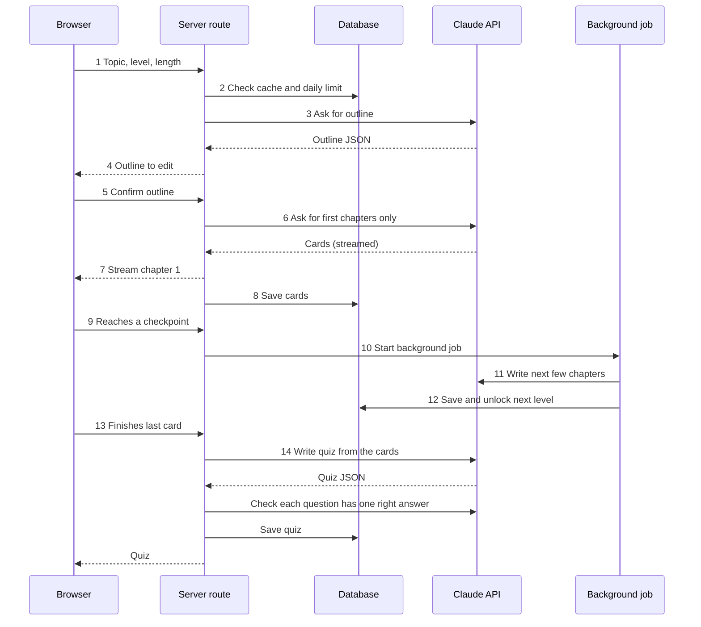
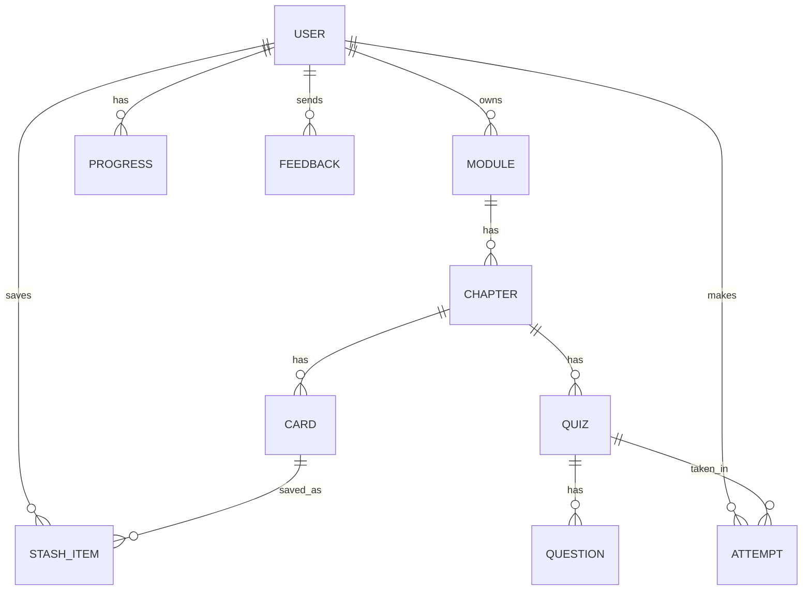

# Architecture

Last updated: 2026-11-14. Decisions and reasons are in [decisions.md](decisions.md). Requirements are in [system-analysis.md](system-analysis.md).

## 1. Summary

One mobile-first web app (a PWA) talks to serverless routes. The routes check the user, read and write Supabase, and call the Claude API. Course content is written in small steps: titles first, then a few chapters ahead of the learner. Quizzes are written only from the chapter the learner just read.

## 2. Components

| Component | Role | Tech |
| --- | --- | --- |
| Web app | Screens, swipe reader, quiz, offline cache of the current module | Next.js, React, TypeScript, Tailwind |
| Server routes | Auth check, limits, cache lookup, calls to Claude, streaming to the browser | Next.js route handlers on Vercel |
| Database and auth | Users, modules, chapters, cards, quizzes, progress, stash, feedback | Supabase Postgres, Supabase Auth, row-level security |
| Claude API | Outline, cards, quiz, quiz check, "Ask Claude", discussion replies | Claude API, server side only |
| Background jobs | Write the next chapters at checkpoints, daily review scheduling | Serverless jobs or queue (see ADR-009) |
| Speech services | Speech to text and text to speech for discussions | Provider to be chosen (open) |
| Analytics | Event tracking for the success metrics | PostHog |
| Payments (later) | Plus subscription | Stripe |

## 3. Request flow

## 4. Generation pipeline

Titles are written up front. Content is not.

| Step | Input | Output | Model tier |
| --- | --- | --- | --- |
| Outline | Topic, level, length, goal | Module title, summary, N chapter titles with objectives | Smaller, faster |
| Cards | Outline plus one chapter | 8 to 12 cards: title, body (45 words or fewer), optional example | Stronger |
| Quiz | That chapter's cards only | 5 questions: stem, 4 options, correct index, 1-line reason, source card | Smaller, faster |
| Quiz check | Quiz plus cards | Pass or flagged questions | Smaller, faster |

Rules:

- Every call uses a JSON schema. Invalid output is retried once, then shown as a retry button. No half-built chapter is ever shown.
- Quiz input contains only the chapter's cards, so questions cannot test unseen material.
- Results are cached by topic, level and length. A cache hit is copied to the user.
- Per-user daily generation limits and per-chapter token budgets apply.

### Chapter states and release

| State | What exists | Becomes |
| --- | --- | --- |
| Locked | Title and one-line description | Next up when the learner starts the chapter before it |
| Next up | Cards written, quiz not yet written | Open after the learner passes the quiz of the chapter before |
| Open | Cards and quiz written | Done when the quiz is finished |

First load writes the outline plus chapters 1 and 2. Starting a chapter is a checkpoint that triggers a background job to write the next two. A learner who stops after chapter 2 costs about four chapters of writing, not the whole course.

## 5. Data model

| Entity | Key fields |
| --- | --- |
| User | id, email, default level, default length, text size, reminder time, voice on or off, streak |
| Module | id, user id, topic, level, length, title, summary, status, archived, created at |
| Chapter | id, module id, order, title, objectives, state (locked, next up, open, done) |
| Card | id, chapter id, order, title, body, example |
| Quiz | id, chapter id, version, created at |
| Question | id, quiz id, stem, options, correct index, reason, source card id |
| Progress | user id, module id, chapter id, card index, state (reading, quiz, done), updated at |
| Attempt | id, user id, quiz id, answers, score, time taken |
| Stash item | id, user id, card id, highlight, note, review due |
| Feedback | id, user id, target (card or question), rating, report text |

Row-level security locks every row to its owner. Cached modules are copied per user, never shared by reference.

## 6. Reader and quiz on the client

- The reader is a vertical stack of full-screen cards using CSS scroll-snap, with tap targets and arrow buttons as an accessible alternative to swiping.
- Progress (chapter, card index, state) is saved on every swipe and answer, and mirrored in IndexedDB so Continue is instant.
- Quiz answers lock on tap, show right or wrong with an icon and the reason, then move on. A retry round uses only the missed questions.

## 7. Voice discussion and presentation practice

Hold-to-speak keeps the microphone closed unless the button is held.

1. Browser records audio only while the button is held (Space key works too).
2. On release, a speech-to-text service returns text.
3. Server sends the text to Claude with the chapter's cards as the only source.
4. The reply is shown as text and read aloud by a text-to-speech service.

Controls: 10-minute session cap, daily minute limit on the free plan, microphone permission only on first use, saved transcript, typed fallback, switch in Settings. Presentation practice uses the same flow: Claude drafts talking points from the chapter, the learner rehearses, Claude says which points were covered or missed.

## 8. Memorising and review

Flashcards are built from cards and quiz answers already stored, so they add no new Claude calls. "Again" cards and missed quiz questions return in a daily 5-question review.

## 9. Security and privacy

- API keys are server secrets. The browser never sees the Claude key.
- Rate limits per user and per IP.
- The topic field is treated as untrusted text so it cannot change the instructions given to Claude.
- A topic check runs before the outline. Harmful topics are refused with a clear message. Medical, legal and money topics show a "general information, not advice" banner.
- Private by default. Export and delete on request.

## 10. Cost controls

AI calls are the main cost. Levers: cache by topic, smaller model for outline and quiz, token caps per chapter, write-ahead of two chapters only, free tier of 3 modules, daily limits, voice minutes cap. Target: under 0.15 USD per generated module (to be measured).

## 11. Performance targets

| Measure | Target |
| --- | --- |
| Outline ready | Under 15 s |
| Chapter 1 readable | Under 20 s |
| Swipe response | Under 100 ms |
| Cold start on a mid-range phone | Under 2 s |

## 12. Deployment and operations

- Hosting: Vercel (web and serverless routes). Database and auth: Supabase.
- Environments: local, preview per pull request, production.
- Observability: runtime logs, error tracking, PostHog events (module created, card viewed, quiz started, quiz passed, discussion started).
- Backups: Supabase automated backups.

## 13. Open items

- Speech provider choice and streaming of voice replies.
- Where background jobs run (see ADR-009).
- Free-tier limits and Plus price.
