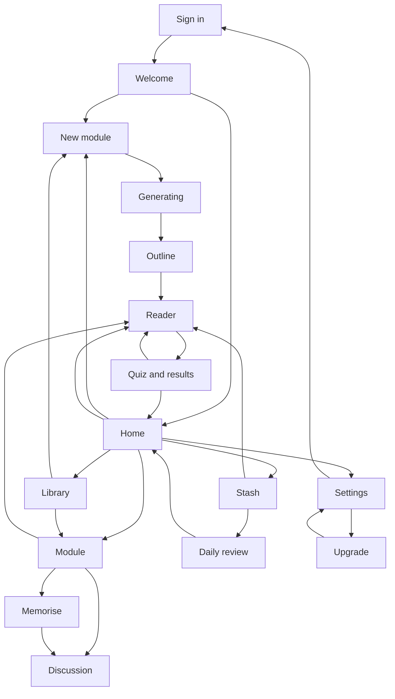

# System Analysis

Last updated: 2026-11-14. Architecture is in [architecture.md](architecture.md), reasons in [decisions.md](decisions.md), work items in [tasks.md](tasks.md).

## 1. Purpose and scope

**Purpose.** Let anyone learn any topic in short, swipeable lessons written by Claude, with a quiz after every chapter so the learning sticks.

**In scope (v1).** Account, create and edit a module, read by swiping, chapter quizzes, resume, progress, library, stash, daily review, settings, hold-to-speak discussion, flashcards, free tier.

**Out of scope (v1).** Social feed, user-published courses, video, live tutors, certificates, offline AI generation.

## 2. Actors

| Actor | Description |
| --- | --- |
| Learner | Signed-in person creating and studying modules. Main user. |
| Claude (AI service) | Writes outlines, cards, quizzes, explanations and discussion replies. |
| Speech service | Converts speech to text and text to speech (provider open). |
| Background job | Writes upcoming chapters at checkpoints and schedules reviews. |
| Payment provider | Handles Plus checkout (later). |
| Admin | Reads feedback and reports, retires bad cached content. |

## 3. Use cases

| ID | Use case | Main flow | Alternative or error |
| --- | --- | --- | --- |
| UC-1 | Sign up and set a goal | Sign in, pick daily minutes and reminder | Skip the goal; sign-in link not received |
| UC-2 | Create a module | Type topic, pick level and length, wait, review outline, start | Topic refused by safety check; generation fails, retry; free limit reached, see Upgrade |
| UC-3 | Edit the outline | Remove chapters or regenerate | Cannot remove the last chapter |
| UC-4 | Read a chapter | Swipe through cards, save cards, ask Claude | Connection drops: cached module stays readable |
| UC-5 | Take the quiz | Answer 5 questions, see reason each time, see results | Fewer than 3 right: nudge and retry missed |
| UC-6 | Continue a lesson | Tap Continue, land on the exact card or question | Module archived or deleted |
| UC-7 | Unlock the next chapter | Finish the quiz; background job has already written it | Job not finished: show a short wait |
| UC-8 | Manage the library | Search, filter, open, archive, delete | No match: clear filters or create new |
| UC-9 | Review daily | Answer saved and missed questions | Nothing due: say so |
| UC-10 | Discuss with Claude | Hold to speak, release, hear and read reply | Mic denied: typed fallback; session cap reached |
| UC-11 | Memorise or practise a talk | Flip flashcards; rehearse talking points aloud | Voice off in Settings |
| UC-12 | Change settings | Level, length, text size, reminder, voice, export, delete account | Delete needs confirmation |
| UC-13 | Upgrade | Open Upgrade, pay through the provider | Declined: stay on free plan |

## 4. Functional requirements

Priority: P0 = MVP, P1 = fast follow, P2 = later.

| ID | Requirement | Pri | Use case |
| --- | --- | --- | --- |
| FR-1 | Create a module from a free-text topic (up to 200 characters), level and length; outline within 15 s | P0 | UC-2 |
| FR-2 | Review and edit the outline before generation; regenerate | P0 | UC-3 |
| FR-3 | Generate chapters one at a time, streamed; chapter 1 readable within 20 s | P0 | UC-2 |
| FR-4 | Begin a lesson at chapter 1, card 1, with title, time and card count | P0 | UC-4 |
| FR-5 | Continue resumes the exact card or question, across devices | P0 | UC-6 |
| FR-6 | Swipe navigation under 100 ms, with tap and button alternatives | P0 | UC-4 |
| FR-7 | Chapter quiz of 5 multiple-choice questions from that chapter only, with feedback and a reason | P0 | UC-5 |
| FR-8 | Results: score, missed items, retry missed, link back to the card | P0 | UC-5 |
| FR-9 | Progress per module: chapters done, quiz scores, time spent, streak | P0 | UC-6 |
| FR-10 | Library: list, search, filter, rename, archive, delete | P0 | UC-8 |
| FR-11 | Accounts and sync (email link, Apple, Google) | P0 | UC-1 |
| FR-12 | Save a card to the Stash; browse and search | P1 | UC-4 |
| FR-13 | Highlight text and add notes | P1 | UC-4 |
| FR-14 | Daily review of missed questions and saved cards | P1 | UC-9 |
| FR-15 | Ask Claude on a card: explain simpler, give an example, ask a question | P1 | UC-4 |
| FR-16 | Regenerate a chapter; Go deeper bonus chapter | P1 | UC-4 |
| FR-17 | Daily reminder and streak | P1 | UC-1 |
| FR-18 | Retake a quiz with fresh questions | P1 | UC-5 |
| FR-19 | Final exam of 10 questions | P2 | UC-5 |
| FR-20 | Share an outline or card by link | P2 | UC-4 |
| FR-21 | Offline reading of downloaded modules | P2 | UC-4 |
| FR-22 | Web-grounded mode with sources | P2 | UC-4 |
| FR-23 | Settings: level, length, text size, reminder, voice, export, delete | P0 | UC-12 |
| FR-24 | Feedback: thumbs and report on every card and question | P0 | UC-4 |
| FR-25 | Safety filter for harmful topics; advice banner for medical, legal, money | P0 | UC-2 |
| FR-26 | Generate ahead and lock: write the outline and chapters 1 and 2, write the next two at each checkpoint, show locked chapters, release one step ahead | P0 | UC-7 |
| FR-27 | Course structure from learning research: overview and 12 weekly modules with lecture, tutorial, discussion, assessment | P2 | UC-2 |
| FR-28 | Hold-to-speak discussion with Claude: 10-minute cap, transcript, typed fallback | P1 | UC-10 |
| FR-29 | Memorise flashcards from stored cards and answers | P1 | UC-11 |
| FR-30 | Presentation practice: talking points, rehearsal, coverage feedback | P1 | UC-11 |
| FR-31 | Free plan of 3 modules and an Upgrade screen | P1 | UC-13 |

## 5. Non-functional requirements

| Area | Requirement |
| --- | --- |
| Performance | Outline under 15 s, chapter 1 under 20 s, swipe under 100 ms, cold start under 2 s |
| Reliability | Generation resumable; failed call shows retry, never a half chapter; invalid AI output retried once |
| Accessibility | WCAG 2.1 AA: screen reader, text size, 4.5:1 contrast, no gesture-only controls, right and wrong shown by icon and word |
| Privacy | Private by default; export and delete; no content in analytics; microphone only while held |
| Security | Keys server side; rate limits; untrusted topic text; row-level security |
| Cost | Under 0.15 USD per generated module (to be measured); daily limits; cache |
| Compatibility | Current iOS Safari and Android Chrome, plus desktop browsers |
| Language | English at launch; output language selectable later |

## 6. Screens and navigation

16 screens in the prototype. Main tabs: Home, Library, Stash, You.

| # | Screen | Purpose | Requirements |
| --- | --- | --- | --- |
| 1 | Sign in | Apple, Google or email link | FR-11 |
| 2 | Welcome | Daily goal, reminder, AI notice | FR-17 |
| 3 | Home | Continue card, new module, module list, streak | FR-5, FR-9 |
| 4 | New module | Topic, level, length | FR-1 |
| 5 | Generating | Progress while the outline is written | FR-1 |
| 6 | Outline | Remove chapters, regenerate, start | FR-2 |
| 7 | Reader | Swipe cards, save, Ask Claude | FR-4, FR-6, FR-12, FR-15 |
| 8 | Quiz and results | Five questions, score, retry missed | FR-7, FR-8 |
| 9 | Module | Chapter rows (open, next up, locked), Discuss, Memorise | FR-10, FR-26 |
| 10 | Discussion | Hold to speak, presentation mode | FR-28, FR-30 |
| 11 | Memorise | Flip flashcards | FR-29 |
| 12 | Library | Search, filters, new module | FR-10 |
| 13 | Stash | Saved cards, start daily review | FR-12 |
| 14 | Daily review | Mixed questions from missed and saved | FR-14 |
| 15 | Settings | Preferences, export, sign out, delete | FR-23 |
| 16 | Upgrade | Free versus Plus | FR-31 |

Every button in the prototype either opens one of these screens or responds on the spot (selects a chip, flips a card, toggles a switch, opens a sheet). The full button-to-destination table is on the design canvas.

## 7. State machines

**Chapter**

| From | Event | To |
| --- | --- | --- |
| Locked | Learner starts the chapter before | Next up (cards written) |
| Next up | Learner finishes the quiz of the chapter before | Open |
| Open | Learner finishes this chapter's quiz | Done |

**Module**

| From | Event | To |
| --- | --- | --- |
| Outlining | Outline accepted | Generating |
| Generating | Chapters 1 and 2 saved | Ready |
| Ready | Learner archives | Archived |
| Ready | All chapters done | Done |

**Quiz round**

| From | Event | To |
| --- | --- | --- |
| Question shown | Option tapped | Answered (locked, reason shown) |
| Answered | Next, and more questions left | Question shown |
| Answered | Next, and no more questions | Results |
| Results | Retry missed | Question shown (missed only) |

## 8. AI behaviour specification

| Task | Input | Output rules |
| --- | --- | --- |
| Outline | Topic, level, length, goal | Title, summary, N chapters with objectives |
| Cards | Outline and one chapter | 8 to 12 cards; one idea each; body 45 words or fewer; plain words; concrete example or analogy where it helps |
| Quiz | That chapter's cards only | 5 questions; 4 options; one correct; plausible wrong answers; reason of one sentence; source card |
| Quiz check | Quiz and cards | Flag questions with no or several defensible answers |
| Ask Claude | One card | Short answer; simpler wording or one example |
| Discussion | Transcript and the chapter's cards | Stay on the chapter; short spoken-style replies |
| Presentation | Chapter and talk length | Talking points; after rehearsal, list covered and missed points |

All outputs follow a JSON schema. Refused topics return a clear message and no content.

## 9. Assumptions and constraints

- Web-first; native wrapper later.
- Claude API and Supabase are available and priced as expected.
- Voice provider is not chosen; voice work waits on that decision.
- The design canvas is the visual reference for all screens and states.

## 10. Risks

| Risk | Impact | Mitigation |
| --- | --- | --- |
| Wrong facts stated with confidence | Loss of trust | Notice, report button, optional sources later, cache retirement |
| Weak or ambiguous quiz questions | Frustration | Chapter-only input, check call, thumbs feedback |
| High AI cost or slow generation | Margin and drop-off | Cache, two model tiers, lookahead of two chapters, streaming |
| Voice cost and privacy | Cost and trust | Push-to-talk, 10-minute cap, daily limit, off switch |
| Generic-feeling courses | Low retention | Level and goal inputs, Go deeper, discussion |
| Background job failures | Next chapter missing | Idempotent jobs, resume, short wait fallback |

## 11. Traceability

| Requirement group | Screens | Tasks |
| --- | --- | --- |
| Create and outline (FR-1 to FR-3, FR-25) | New module, Generating, Outline | T-020 to T-027 |
| Read, quiz, resume (FR-4 to FR-9) | Reader, Quiz and results, Home | T-030 to T-037 |
| Library and settings (FR-10, FR-23, FR-24) | Library, Module, Settings | T-036, T-038, T-039 |
| Accounts (FR-11, FR-17) | Sign in, Welcome | T-013, T-040, T-064 |
| Stash and review (FR-12 to FR-15, FR-18) | Stash, Daily review, Reader | T-060 to T-065 |
| Generate ahead (FR-26) | Module | T-050 to T-055 |
| Voice and memorise (FR-28 to FR-30) | Discussion, Memorise | T-067, T-070 to T-075 |
| Course structure and plans (FR-19, FR-27, FR-31) | Module, Upgrade | T-080 to T-082 |
